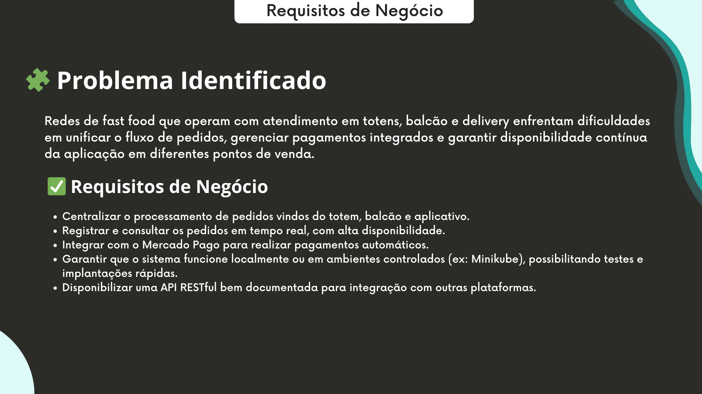
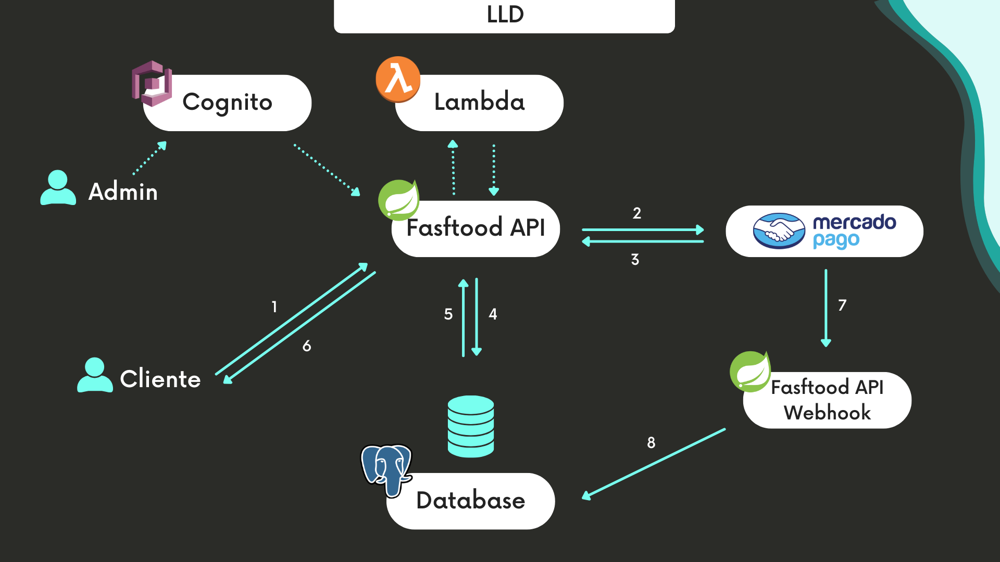
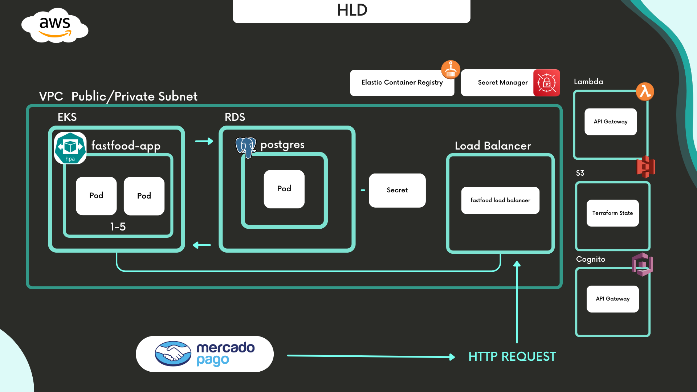
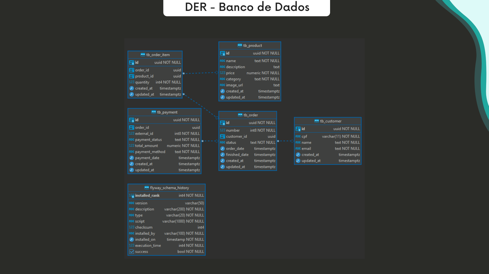

# 🍔 Tech Challenge - FastFood Backend API 🍟

Bem-vindo ao **FastFood Backend Service**!  
Este projeto é uma API desenvolvida em **Kotlin**, responsável por gerenciar as principais funcionalidades de  
um sistema de FastFood, como fluxo de pedidos, integrações com pagamento, e mais.

---

## 📑 Índice

- [Visão Geral](#-visão-geral)
   - [Requisitos de Negócio](#-1-requisitos-de-negócio)
   - [Fluxo de Pedido](#-2-fluxo-de-pedido)
   - [Arquitetura na AWS](#-3-arquitetura-na-aws)
   - [Diagrama Entidade-Relacionamento (DER)](#-4-diagrama-entidade-relacionamento-der)
- [Guia Rápido de Inicialização (Docker Compose)](#-guia-rápido-de-inicialização-docker-compose)
   - [Variáveis de Ambiente](#-variáveis-de-ambiente)
   - [Subindo com Docker Compose](#-subindo-com-docker-compose)
- [Deploy no Kubernetes (K8S / Minikube)](#-deploy-no-kubernetes-k8s--minikube)
   - [Pré-requisitos](#-pré-requisitos)
   - [Passo 1 – Build das Imagens](#-passo-1--build-das-imagens)
   - [Passo 2 – Aplicando os Manifests do Kubernetes](#-passo-2--aplicando-os-manifests-do-kubernetes)
- [Acessando o PostgreSQL via DBeaver](#-acessando-o-postgresql-via-dbeaver)
   - [Opção 1 – kubectl port-forward (recomendado)](#-opção-1--kubectl-port-forward-recomendado)
   - [Opção 2 – NodePort (menos seguro)](#-opção-2--nodeport-menos-seguro)
- [Verificações Úteis](#-verificações-úteis)
- [Acessando a Aplicação](#-acessando-a-aplicação)
   - [Ingress](#-ingress)
   - [URL Pública com ngrok](#-url-pública-com-ngrok)
   - [Alternativa via IP do Minikube](#-alternativa-via-ip-do-minikube)
- [Integração com Spring Boot](#-integração-com-spring-boot)
- [Documentação Swagger](#-documentação-swagger)
- [Dicas e Solução de Problemas](#-dicas-e-solução-de-problemas)
- [Apresentação em Vídeo](#-apresentação-em-vídeo)

---

## 📋 Visão Geral

### 📌 1. Requisitos de Negócio

#### 🧩 Problema Indentificado
Redes de fast food que operam com atendimento em totens, balcão e delivery enfrentam dificuldades em  
unificar o fluxo de pedidos, gerenciar pagamento integrados e garantir disponibilidade continua da  
aplicação em diferentes pontos de venda.

#### ✅ Requisitos de Negócio

- Centralizar o processamento de pedidos vindos do totem, balcão e aplicativo.
- Registrar e consultar os pedidos em tempo real, com alta disponibilidade.
- Integrar com o Mercado Pago para realizar pagamentos automáticos.
- Garantir que o sistema funcione localmente ou em ambientes controlados (ex: Minikube), possibilitando  
testes e implantações rápidas.
- Disponibilizar uma API RESTful bem documentada para integração com outras plataformas.


[//]: # ()

---

### 🔄 2. Fluxo de Pedido



---

### ☁️ 3. Arquitetura na AWS



---

### 🗄️ 4. Diagrama Entidade-Relacionamento (DER)



---

## ⚙️ Guia Rápido de Inicialização (Docker Compose)

Este projeto utiliza Docker Compose para criar rapidamente um ambiente local com PostgreSQL.

### 📁 Variáveis de Ambiente

Crie um arquivo `.env` baseado em `.env.sample`. As variáveis necessárias são:

| Variável                    | Descrição                                                  |
|-----------------------------|------------------------------------------------------------|
| `DATABASE`                  | Nome do banco de dados que será criado pelo Docker Compose |
| `DATABASE_HOST`             | Host onde o serviço PostgreSQL estará acessível            |
| `DATABASE_USER`             | Usuário para autenticação no PostgreSQL                    |
| `DATABASE_PASSWORD`         | Senha do usuário do PostgreSQL                             |
| `DATABASE_PORT`             | Porta para acesso ao PostgreSQL (padrão é `5432`)          |
| `MERCADO_PAGO_ACCESS_TOKEN` | Token de acesso para a sdk do mercado pago                 |
| `AUHT_SERVICE_URL`          | URL do Lambda de autenticação de usuário                   |

---

## 🚀 Subindo com Docker Compose

1. **Crie o arquivo `.env`:**

   Duplique o `.env.sample` para criar o seu `.env` personalizado.

   ```bash
   cp .env.sample .env
   ```
   
2. **Edite os valores conforme necessário:**

   Edite o `.env` com os valores desejados.

   ```plaintext
   DATABASE=db_example
   DATABASE_USER=user_example
   DATABASE_PASSWORD=password_example
   DATABASE_PORT=5432
   MERCADO_PAGO_ACCESS_TOKEN=TOKEN
   ```
   
3. **Execute:**

   Suba o ambiente com **Docker Compose**.

   ```bash
   docker-compose up --build -d
   ```
   
---

## ☸️ Deploy no Kubernetes (K8S / Minikube)

### 🧱 Pré-requisitos

- [Minikube](https://minikube.sigs.k8s.io/)
- [kubectl](https://kubernetes.io/docs/tasks/tools/)
- [ngrok](https://ngrok.com/)

### 🐳 Passo 1 – Build das Imagens

Antes de aplicar os manifests do Kubernetes, é necessário construir as imagens Docker localmente  
e disponibilizá-las para o Minikube.

#### 🔹 MacOS/Linux

```bash
   bash ./setup-infra.sh
```

Ou manualmente:

```bash
   minikube start
   eval $(minikube docker-env)
   docker build -f infra/db/Dockerfile -t fastfood-postgres:latest .
   docker build -t tech-challenge-fastfood:latest .
```

#### 🔹 Windows (PowerShell)

```bash
   ./setup-infra.psi
```

Ou manualmente:

```bash
   minikube start
   Invoke-Expression -Command "$(minikube docker-env | Out-String)"
   docker build -f infra/db/Dockerfile -t fastfood-postgres:latest .
   docker build -t tech-challenge-fastfood:latest .
```

> 💡 **DICA:** Execute sempre a partir da raiz do projeto.

### 📦 Passo 2 – Aplicando os Manifests do Kubernetes

```bash
   kubectl apply -f k8s/
```

Caso precise reiniciar do zero:

```bash
   kubectl delete deployment postgres fastfood-app
   kubectl delete pvc postgres-pvc
   kubectl delete pv postgres-pv
   kubectl apply -f k8s/
```

---

## 🐘 Acessando o PostgreSQL via DBeaver

### 🔐 Opção 1 – kubectl port-forward (recomendado)

```bash
    kubectl get pods
    kubectl port-forward pod/<nome-do-pod> 5432:5432
```

Configuração no DBeaver:

```plaintext
   HOST:       localhost
   PORT:       5432
   DATABASE:   fastfood_db
   USER:       fastfood
   PASSWORD:   Teste123
```

> **🚨 IMPORTANTE:** Mantenha o terminal aberto durante a conexão.

### 🌐 Opção 2 – NodePort (menos seguro)

Edite `postgres-service.yaml`:

```yaml
   spec:
     type: NodePort
     ports:
       - port: 5432
         targetPort: 5432
         nodePort: 30032
```

Descubra o IP do Minikube:

```bash
   minikube ip
```

Use no DBeaver:

```
   HOST: <IP do Minikube>
   PORT: 30032
   DATABASE: fastfood_db
   USER: fastfood
   PASSWORD: Teste123
```

---

## 🔍 Verificações Úteis

- **Verificar pods:**

```bash
   kubectl get pods
```

- **Logs do Banco e da Aplicação:**

```bash
   kubectl logs deployment/postgres
   kubectl logs deployment/fastfood-app
```

- **Verificar PVC e PV:**

```bash
   kubectl get pvc
   kubectl get pv
```

- **Dashboard:**

```bash
   minikube dashboard
```

> **📌 OBSERVAÇÕES:**
> - O script SQL só roda na **primeira vez**, quando o volume está limpo.
> - Para forçar nova execução:
>  ```bash
>  kubectl delete pvc postgres-pvc
>  kubectl delete pv postgres-pv
>  ```
> - O banco é acessado internamente via `postgres-service`.
> - Variáveis da aplicação estão nos `ConfigMaps` e `Secrets`.

--- 

## 🌐 Acessando a Aplicação

### 🔗 Ingress

Acesse via:

**`http://springboot.local.com` (adicione ao `/etc/hosts`):**

```bash
   127.0.0.1 springboot.local.com
```

### 📡 URL Pública com ngrok

Obtenha a URL gerada:

```bash
   kubectl logs deployment/ngrok
```

Exemplo de saída:

``
t=2025-03-22T22:50:50+0000 lvl=info msg="started tunnel" obj=tunnels name=fastfood addr=http://ingress-nginx-controller.ingress-nginx:80 url=https://fb82-189-68-138-48.ngrok-free.app
``

### 💻 Alternativa via IP do Minikube

```bash
   minikube ip
```

Use:

```
   http://<IP_DO_MINIKUBE>
```

> **❓ INFO:** Aplicação também estará disponível em `http://localhost:8080` (via Docker Compose). 

---

## 💾 Integração com Spring Boot

O Spring Boot detecta automaticamente as variáveis de ambiente para configurar a conexão com o banco.  
Isso vale tanto para o `.env` local quanto para os `Secrets` e `ConfigMaps` no Kubernetes.

### 🧑‍💻 Documentação Swagger

A API está documentada com **Swagger UI**. Acesse:

- **Docker Compose:**

  ```plaintext
  http://localhost:8080/swagger-ui
  ```

- **Kubernetes (Minikube):**

  ```plaintext
  http://<IP_DO_MINIKUBE>/swagger-ui
  ```

- **Ingress:**

  ```plaintext
  http://springboot.local.com/swagger-ui
  ```
  
---

## 🧠 Dicas e Solução de Problemas

- **Erro de conexão com o banco?**

  Verifique se o ambiente (Docker ou Minikube) está ativo.  


- **Variáveis não reconhecidas?**

  Confirme se o `.env` está correto ou se os `ConfigMaps/Secrets` foram aplicados.  


- **Script SQL não executado?**

  Rode:  

  ```bash
  kubectl delete pvc postgres-pvc
  kubectl delete pv postgres-pv
  ```

Agora você está pronto para codar, testar e gerenciar sua aplicação FastFood com estilo! 🚀🍔🍟


---

## 📽️ Apresentação em Vídeo

[](https://www.youtube.com/watch?v=b7py2u_cs9I)  
